# SkillPath AI System Architecture

## Architecture Overview

SkillPath AI separates user interface rendering, deterministic calculation engines, secure server APIs, and persistent database storage.

```mermaid
graph TD
    subgraph Client ["Client (React + Vite)"]
        UI[Pages & UI Components]
        Context[AppContext State]
        ClientExtractor[In-Browser File/Text Parsing]
    end

    subgraph Engines ["Pure Deterministic TypeScript Engines (src/engine)"]
        TextTools[textTools]
        SkillExt[skillExtractor]
        Verifier[verifier]
        GapAn[gapAnalyzer]
        CareerRank[careerRanker]
        Roadmap[roadmapBuilder]
        TfIdf[tfidf & opportunityMatcher]
        Explain[explain]
        SelfCheck[selfCheck Suite SC01-SC12]
    end

    subgraph Server ["Server (Node.js + Express)"]
        ApiRouter["/api/* Router"]
        QuestionsBank["Secret Question Bank (server/data/questions.ts)"]
        Scorer[Server-Side Grader]
        RateLimiter[24h Rate Limiting]
    end

    subgraph Firebase ["Cloud Firestore & Auth"]
        UsersCol["users/{uid}"]
        ResumeCol["users/{uid}/resume/current (Server Write Only)"]
        AssessmentsCol["users/{uid}/assessments/{id} (Server Write Only)"]
        RoadmapCol["users/{uid}/roadmap/{roleId}"]
        OppsCol["opportunities/{id} (Admin Write Only)"]
        SettingsCol["settings/app"]
    end

    UI --> Context
    ClientExtractor --> TextTools
    Context --> Engines
    UI --> ApiRouter
    ApiRouter --> QuestionsBank
    ApiRouter --> Scorer
    ApiRouter --> RateLimiter
    ApiRouter --> ResumeCol
    ApiRouter --> AssessmentsCol
    Context --> UsersCol
    Context --> RoadmapCol
    Context --> OppsCol
    Context --> SettingsCol
```

## Pure Deterministic Layer

All business logic lives inside `src/engine/`. These functions have:
1. Zero side-effects or network calls.
2. JSDoc comments stating their exact mathematical formula.
3. Automated test fixtures run through `selfCheck.ts` and Node unit tests.
